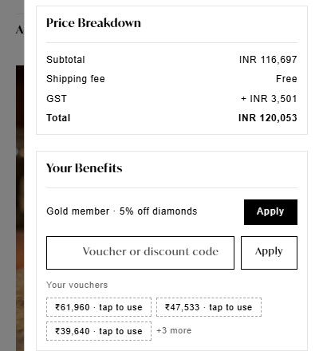

# "Your Benefits" card: design proposal for the cart drawer

*Status: preview only, awaiting the founder's go. Captured 2026-10-12 on timanti.in (Dawn 15.4 "auracarat/main") in a logged-in browser at phone width.*



## Why it changes
The founder's feedback on the shipped bar (2026-10-12):
- It wasn't brand-aligned. It looked like a bolted-on widget.
- The voucher list wrapped into a cluttered block.
- There was a stray semicolon in the profile block.

The drawer needs its own code box, because GoKwik's code entry is switched off, and the founder liked showing all of a customer's benefits.

## Design
The card uses the drawer's **own** classes (`cart-drawer__price-breakdown`, `-title`, `-item`, Dawn `.field` / `.button`), so it inherits the theme exactly:

| | Theme value (read live) |
|---|---|
| Card | 1px `rgba(0,0,0,.1)` border, square corners, 12px padding, 20px 14px margin |
| Heading | IvyMode, 14px, weight 600, capitalised, divider under it |
| Rows | Mulish, 12px, letter-spacing 0.6px, label left and value/action right |
| Primary button | Black, square, IvyMode, white text |
| Input | Dawn floating-label field, `rgba(0,0,0,.02)` fill |

Layout, placed directly **under "Price Breakdown"** inside the drawer's scroll area:
```
Your Benefits
─────────────────────────────────────
Gold member · 7% off diamonds + 20% off making (up to ₹5,000)     [ Apply ]     → "Applied · ₹984 off   Remove"
[ Voucher or discount code   ]    [ Apply ]     → the cart's own code box
Your vouchers
[₹61,960 · tap to use] [₹47,533 · tap to use] [₹39,640 · tap to use]  +3 more
```

## Behaviour
- **Logged out:** "Log in to see your loyalty benefit", plus the code box.
- **Below tier:** "₹X more to unlock Silver", with no button.
- **Stacking:** loyalty plus one voucher or code is allowed. A promo code is refused alongside loyalty (Shopify's combination settings).
- **Cart changes after applying:** loyalty re-applies itself once for the new contents.
- **Old bar:** the one-line bar under "Continue Shopping" is removed, so the footer is back to Total and Checkout.

## Profile block (customer account)
Already redeployed (app version 50):
- a "Gold member" line in bold;
- "7% off the diamond value + 20% off making (up to ₹5,000 a purchase) on eligible pieces";
- "Lifetime purchases ₹…" and "₹… more to reach Platinum";
- "Extra 2% in your birthday and anniversary months";
- no semicolon, and every line in the same text colour.

Before: `profile-block-current.jpg`. The bar this replaces: `drawer-bar-applied-old.jpg`.

## Open choices
- How many voucher chips show before "+N more" (proposed: 3).
- Whether the card also goes on the full cart page (proposed: yes, same card).
